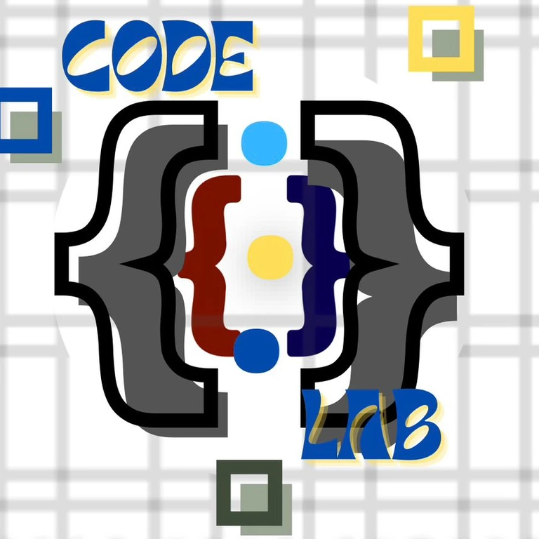

<div align="center">

  

  # PUPCL — President University Pekanbaru Code Lab

  **Official Web Platform for Innovation, Community Collaboration & Student Technology Showcase**

  [](https://github.com/mrizalbasri/CodeLab/actions/workflows/ci.yml)
  [](https://nextjs.org/)
  [](https://react.dev/)
  [](https://www.typescriptlang.org/)
  [](https://tailwindcss.com/)
  [](https://supabase.com/)
  [](https://vitest.dev/)
  [](LICENSE)

  <p align="center">
    <a href="https://codelab-five.vercel.app"><strong>Explore Live Demo »</strong></a>
    <br />
    <br />
    <a href="docs/ARCHITECTURE.md">System Architecture</a>
    ·
    <a href="docs/DATABASE.md">Database Schema</a>
    ·
    <a href="docs/CONTRIBUTING.md">Contributing Guide</a>
    ·
    <a href="AGENTS.md">Agent & AI Conventions</a>
  </p>

</div>

---

## 📌 Daftar Isi (Table of Contents)

- [Ringkasan Proyek](#-ringkasan-proyek)
- [Fitur Utama](#-fitur-utama)
- [Arsitektur & Tech Stack](#-arsitektur--tech-stack)
- [Struktur Direktori](#-struktur-direktori)
- [Panduan Memulai (Quick Start)](#-panduan-memulai-quick-start)
  - [Prasyarat Sistem](#1-prasyarat-sistem)
  - [Instalasi](#2-instalasi-dan-setup)
  - [Variabel Lingkungan](#3-konfigurasi-environment-variables)
  - [Menjalankan Aplikasi](#4-menjalankan-server-pengembangan)
- [Perintah Kerja (NPM Scripts)](#-perintah-kerja-npm-scripts)
- [Pengujian & Kualitas Kode](#-pengujian--kualitas-kode)
- [Alur Kontribusi & Standar Commit](#-alur-kontribusi--standar-commit)
- [Dokumentasi Terkait](#-dokumentasi-terkait)
- [Tim & Kontributor](#-tim--kontributor)
- [Lisensi](#-lisensi)

---

## 💡 Ringkasan Proyek

PUPCL Web Platform dirancang untuk memfasilitasi kebutuhan publikasi dan operasional komunitas teknologi di President University Pekanbaru. Platform ini mencakup profil kelembagaan, direktori pengurus dan anggota, publikasi agenda kegiatan dan workshop, dokumentasi galeri proyek, serta sistem Content Management System (CMS) internal yang terproteksi.

Arsitektur aplikasi mengimplementasikan prinsip server-first rendering dengan Server Components, optimasi performa melalui Turbopack, serta mekanisme autentikasi dan otorisasi terintegrasi.

---

## ✨ Fitur Utama

- **⚡ Antarmuka Modern & Responsif**: Dibangun menggunakan Tailwind CSS v4 dan Motion, mendukung transisi interaktif serta kompatibilitas lintas perangkat.
- **🌗 Dukungan Tema Adaptif**: Fitur Dark Mode dan Light Mode dengan sinkronisasi preferensi sistem dan penyimpanan lokal pengguna.
- **🌐 Multibahasa (Bilingual ID / EN)**: Dukungan penuh dua bahasa (Bahasa Indonesia dan Bahasa Inggris) dengan pemuatan dinamis berbasis React Context.
- **👥 Direktori Pengurus dan Anggota**: Sistem pencarian dan paginasi data profil kepengurusan, divisi, dan riwayat peran anggota.
- **🚀 Manajemen Program dan Galeri**: Publikasi jadwal kegiatan, materi workshop, dan dokumentasi portofolio proyek secara terstruktur.
- **🛡️ Panel Administrasi Terproteksi**: Modul CRUD data kegiatan dan anggota yang diamankan melalui Next.js Middleware dan Supabase Authentication.
- **🔒 Keamanan Data & Resiliensi**: Pengamanan level basis data menggunakan Row Level Security (RLS) Supabase serta ketersediaan data fallback saat koneksi offline.

---

## 🛠️ Arsitektur & Tech Stack

```mermaid
flowchart LR
    Client([Client / Browser]) -->|Request| Edge[Next.js Middleware]
    Edge -->|Public Routes| Pages[Server / Client Components]
    Edge -->|Protected Routes| AuthCheck{Supabase Auth SSR}
    AuthCheck -->|Authenticated| Admin[Admin Dashboard & Actions]
    AuthCheck -->|Unauthorized| Login[/login]
    Pages -->|Data Query| Supabase[(Supabase PostgreSQL)]
    Admin -->|CRUD / Storage| Supabase
    Pages -.->|Offline / Fallback| StaticData[(lib/data Fallback)]
```

| Kategori | Teknologi | Deskripsi & Kegunaan |
|---|---|---|
| **Core Framework** | [Next.js 16 (App Router)](https://nextjs.org/) | Framework React full-stack dengan Server Components & Server Actions |
| **UI Library** | [React 19](https://react.dev/) | Library antarmuka komponen deklaratif terkini |
| **Type System** | [TypeScript 5](https://www.typescriptlang.org/) | Standarisasi type safety statis end-to-end |
| **Styling** | [Tailwind CSS v4](https://tailwindcss.com/) | Engine utility-first CSS modern berbasis PostCSS |
| **Primitif UI** | [Radix UI](https://www.radix-ui.com/) | Komponen UI primitif aksesibel tanpa styling terikat |
| **Animasi** | [Motion (Framer)](https://motion.dev/) | Library animasi deklaratif untuk layout transition |
| **Backend & Database** | [Supabase](https://supabase.com/) | PostgreSQL managed, Row Level Security (RLS), & Auth SSR |
| **Storage** | Supabase Storage | Manajemen aset media dan upload file (`pupcl-uploads`) |
| **Unit Testing** | [Vitest](https://vitest.dev/) | Framework pengujian unit super cepat berbasis Vite |
| **Coverage Tool** | [@vitest/coverage-v8](https://vitest.dev/) | Pembuatan laporan cakupan kode uji (LCOV) |
| **Continuous Integration** | GitHub Actions | Otomasi pengujian, linting, dan build linting otomatis |
| **Hosting & Deploy** | [Vercel](https://vercel.com/) | Platform deployment serverless edge teroptimasi |

---

## Struktur Direktori

```text
web_codelab/
├── app/                      # Konfigurasi rute Next.js App Router
│   ├── (admin)/              # Rute terproteksi untuk administrasi
│   │   └── admin/            # Dashboard panel admin (/admin)
│   ├── (public)/             # Rute publik yang dapat diakses umum
│   │   ├── about/            # Halaman profil organisasi dan struktur kepengurusan
│   │   ├── contact/          # Halaman formulir kontak dan narahubung
│   │   ├── gallery/          # Galeri dokumentasi kegiatan dan proyek
│   │   ├── login/            # Halaman autentikasi administrator (/login)
│   │   ├── programs/         # Halaman agenda dan program kerja
│   │   ├── layout.tsx        # Layout publik (Navbar, Footer, ScrollToTop)
│   │   ├── page.tsx          # Beranda utama
│   │   └── template.tsx      # Animasi transisi halaman
│   ├── actions.ts            # Entry point Server Actions
│   ├── globals.css           # Konfigurasi stylesheet global dan variabel tema
│   ├── layout.tsx            # Root layout aplikasi (Provider tema dan bahasa)
│   └── not-found.tsx         # Penanganan tampilan rute 404 kustom
├── components/               # Komponen antarmuka modular
│   ├── admin/                # Komponen manajemen data admin
│   ├── ui/                   # Komponen primitif antarmuka
│   ├── BentoGrid.tsx         # Grid interaktif pilar dan statistik komunitas
│   ├── Footer.tsx            # Komponen navigasi bawah dan hak cipta
│   ├── HeroAnimations.tsx    # Animasi visual dan interaktivitas beranda
│   ├── LanguageToggle.tsx    # Komponen pengalih bahasa (ID / EN)
│   ├── MemberCard.tsx        # Kartu informasi profil anggota
│   ├── MemberSection.tsx     # Pengelompokan anggota per divisi
│   ├── Navbar.tsx            # Navigasi utama responsif
│   ├── Pagination.tsx        # Navigasi paginasi data
│   ├── SearchBar.tsx         # Kolom pencarian dinamis
│   ├── TechStackBeam.tsx     # Visualisasi stack teknologi
│   └── ThemeToggle.tsx       # Pengalih mode tampilan gelap / terang
├── context/                  # State management berbasis React Context
│   └── LanguageContext.tsx   # Pengaturan bahasa dan persistensi penyimpanan lokal
├── docs/                     # Dokumentasi teknis sistem
│   ├── ARCHITECTURE.md       # Arsitektur sistem dan data flow
│   ├── DATABASE.md           # Skema basis data, DDL, dan RLS
│   └── CONTRIBUTING.md       # Standar kontribusi dan konvensi kode
├── lib/                      # Modul utilitas dan logika bisnis
│   ├── actions/              # Definisi mutasi data (Server Actions)
│   ├── data/                 # Data statis fallback saat offline
│   ├── hooks/                # Custom React Hooks (pencarian, paginasi)
│   ├── monitoring/           # Utilitas error tracking dan logging
│   ├── supabase/             # Client konfigurasi Supabase (Client, Server, Middleware)
│   ├── translations.ts       # Kamus lokalisasi multibahasa (ID / EN)
│   ├── types.ts              # Definisi interface dan tipe TypeScript
│   └── utils.ts              # Fungsi pembantu (format tanggal, class merger)
├── public/                   # Berkas aset statis publik
└── middleware.ts             # Middleware proteksi autentikasi rute
```

---

## 🚀 Panduan Memulai (Quick Start)

### 1. Prasyarat Sistem
- **Node.js**: versi `20.x` atau `22.x` (LTS direkomendasikan)
- **Package Manager**: `npm`, `pnpm`, atau `yarn`
- **Git**: versi terbaru

### 2. Instalasi dan Setup

Kloning repositori ke mesin lokal Anda:
```bash
git clone git@github.com:mrizalbasri/CodeLab.git
cd CodeLab
```

Instal dependensi proyek:
```bash
npm install
```

### 3. Konfigurasi Environment Variables

Salin berkas konfigurasi template:
```bash
cp .env.local.example .env.local
```

Sesuaikan nilai variabel lingkungan pada `.env.local`:

| Nama Variabel | Wajib/Opsional | Deskripsi |
|---|---|---|
| `NEXT_PUBLIC_SUPABASE_URL` | Direkomendasikan | URL endpoint REST API proyek Supabase |
| `NEXT_PUBLIC_SUPABASE_ANON_KEY` | Direkomendasikan | Kunci API anonim publik untuk komunikasi klien |
| `WEB3FORMS_ACCESS_KEY` | Opsional | Kunci akses API untuk gateway formulir kontak |
| `NEXT_PUBLIC_GA_ID` | Opsional | Measurement ID Google Analytics 4 |

> [!NOTE]
> Jika variabel Supabase tidak diisi saat pengembangan lokal, aplikasi akan otomatis beralih ke mode **Fallback Statis** (`lib/data/`), sehingga seluruh rute publik tetap dapat dijelajahi dengan sempurna tanpa koneksi database.

### 4. Menjalankan Server Pengembangan

Jalankan server pengembangan:
```bash
npm run dev
```

Buka peramban di [http://localhost:3000](http://localhost:3000) untuk melihat hasilnya.

---

## ⌨️ Perintah Kerja (NPM Scripts)

| Perintah | Fungsi / Kegunaan |
|---|---|
| `npm run dev` | Menjalankan local development server dengan Turbopack |
| `npm run build` | Menjalankan kompilasi dan optimasi bundle produksi Next.js |
| `npm run start` | Menjalankan server aplikasi produksi lokal |
| `npm run lint` | Melakukan audit statis kualitas kode dengan ESLint |
| `npm test` | Menjalankan rangkaian unit test otomatis dengan Vitest |
| `npm run test:coverage` | Menjalankan pengujian unit sekaligus menghitung coverage report |
| `npx tsc --noEmit` | Memverifikasi konsistensi type safety TypeScript secara menyeluruh |

---

## 🧪 Pengujian & Kualitas Kode

Proyek ini menerapkan standar kualitas kode tinggi melalui pengujian otomatis dan type-checking:

```bash
# 1. Jalankan unit test
npm test

# 2. Cek laporan cakupan kode (coverage)
npm run test:coverage

# 3. Validasi tipe TypeScript
npx tsc --noEmit
```

Setiap Pull Request yang diajukan ke branch `main` akan diuji secara otomatis oleh pipeline GitHub Actions CI untuk memastikan tidak ada regresi kode.

---

## 🤝 Alur Kontribusi & Standar Commit

Kami sangat menyambut kontribusi dari seluruh anggota komunitas! Ikuti langkah-langkah berikut:

1. **Buat Branch Fitur Baru**:
   ```bash
   git checkout -b feat/nama-fitur-anda
   ```
2. **Terapkan Standar Conventional Commits**:
   - `feat:` Penambahan fitur baru
   - `fix:` Perbaikan bug / error
   - `docs:` Pembaruan atau penambahan dokumentasi
   - `refactor:` Restrukturisasi kode tanpa mengubah fungsionalitas
   - `chore:` Pemeliharaan dependensi atau konfigurasi alat
3. **Konvensi Kolaborasi & AI**:
   - Untuk kolaborasi agen otomatis atau kontribusi bersama akun kedua, ikuti panduan trailer commit pada [AGENTS.md](AGENTS.md):
     ```text
     feat: add project showcase filter

     Co-authored-by: xanom23 <xanom55@gmail.com>
     ```
4. **Verifikasi Sebelum Mengajukan PR**:
   Pastikan seluruh pengujian dan build berhasil sebelum membuka Pull Request:
   ```bash
   npm test && npx tsc --noEmit && npm run build
   ```

---

## 📚 Dokumentasi Terkait

Untuk pemahaman teknis yang lebih komprehensif, silakan pelajari dokumen pendukung berikut:

- 🏛️ [Dokumentasi Arsitektur](docs/ARCHITECTURE.md) — Alur data, otentikasi middleware, dan strategi rendering.
- 🗄️ [Skema Basis Data](docs/DATABASE.md) — Struktur tabel PostgreSQL, migrasi DDL, dan kebijakan keamanan RLS.
- 🤝 [Panduan Kontribusi](docs/CONTRIBUTING.md) — Tata cara kontribusi, alur branching, dan code review.
- 🤖 [Panduan Agen & AI](AGENTS.md) — Konvensi pair-programming dan atribusi co-author.

---

## 👥 Tim & Kontributor

Terima kasih kepada para pengembang yang berkontribusi dalam membangun dan mengembangkan platform ini:

<table>
  <tr>
    <td align="center">
      <a href="https://github.com/mrizalbasri">
        <br />
        <sub><b>M. Rizal Basri</b></sub>
      </a><br />
      <sub>Lead Maintainer</sub>
    </td>
    <td align="center">
      <a href="https://github.com/xanom23">
        <br />
        <sub><b>xanom23</b></sub>
      </a><br />
      <sub>Core Contributor</sub>
    </td>
  </tr>
</table>

---

## 📄 Lisensi

Proyek ini dikembangkan dan dikelola oleh **President University Pekanbaru Code Lab (PUPCL)**. Didistribusikan di bawah lisensi terbuka [MIT License](LICENSE).

<div align="center">
  <sub>Built with ❤️ by the President University Pekanbaru Code Lab Community</sub>
</div>
