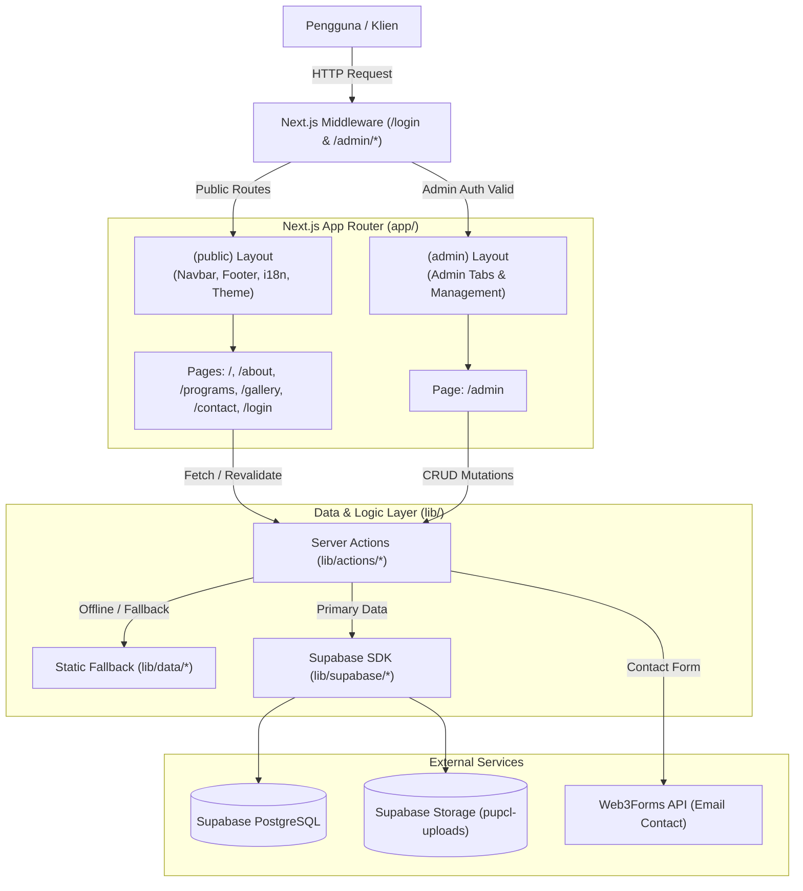

# 🏗️ Architecture Documentation

Dokumen ini menjelaskan rancangan arsitektur, pola desain, alur data, dan struktur teknis proyek **PUPCL (President University Pekanbaru Code Lab)**.

---

## 1. Ikhtisar Arsitektur

Aplikasi dibangun menggunakan **Next.js 16 (App Router)** dengan paradigma hybrid rendering (Server Components secara default dan Client Components untuk interaktivitas dinamis).

---

## 2. Struktur Routing & Route Groups

Next.js App Router mengorganisasi route menggunakan **Route Groups** bertanda kurung `()` yang tidak mempengaruhi segmen URL:

### A. Route Group `(public)`
Menangani seluruh antarmuka publik yang dapat diakses oleh pengunjung umum tanpa autentikasi.
- `app/(public)/layout.tsx`: Membungkus halaman publik dengan `Navbar`, `Footer`, dan tombol `ScrollToTop`.
- `app/(public)/template.tsx`: Memberikan animasi transisi halus antar halaman menggunakan `motion/react`.
- Halaman yang tercakup:
  - `/` (`page.tsx`): Beranda interaktif dengan hero animasi, BentoGrid, dan tech beam.
  - `/about`: Sejarah, visi-misi, pilar komunitas, dan daftar pengurus/anggota.
  - `/programs`: Agenda kegiatan, workshop, pencarian & filter kategori.
  - `/gallery`: Dokumentasi foto kegiatan, proyek, dan prestasi.
  - `/contact`: Form pesan yang terintegrasi dengan Web3Forms.
  - `/login`: Form autentikasi kredensial admin.

### B. Route Group `(admin)`
Menangani dashboard pengelolaan konten terproteksi:
- `app/(admin)/admin/layout.tsx`: Layout khusus admin.
- `app/(admin)/admin/page.tsx`: Manajemen data terpusat dengan tab navigasi:
  - **Members Tab**: Tambah, edit, dan hapus pengurus/anggota serta upload foto.
  - **Programs Tab**: Tambah, edit, dan hapus agenda workshop/kegiatan.
  - **Gallery Tab**: Tambah dan hapus dokumentasi foto & kategori.

---

## 3. Autentikasi & Proteksi Route

- **Middleware Edge** ([`middleware.ts`](file:///d:/Coding/web_codelab/middleware.ts)):
  - Dikonfigurasi dengan `matcher: ["/admin/:path*", "/login"]`.
  - Menggunakan helper [`lib/supabase/middleware.ts`](file:///d:/Coding/web_codelab/lib/supabase/middleware.ts) untuk merefresh cookie token sesi.
  - Jika sesi tidak ditemukan saat mengakses `/admin`, pengguna dialihkan otomatis ke `/login`.
  - Jika pengguna yang sudah login mengakses `/login`, pengguna dialihkan langsung ke `/admin`.
- **Action Guard** ([`lib/actions/utils.ts`](file:///d:/Coding/web_codelab/lib/actions/utils.ts)):
  - Fungsi `checkAuth()` memvalidasi sesi Supabase dari cookie server di setiap operasi mutasi data (Create, Update, Delete).

---

## 4. Alur Data & Server Actions

Seluruh mutasi data menggunakan **Next.js Server Actions** (`"use server"`):

1. **Abstraksi Server Actions**:
   - Ditempatkan di [`lib/actions/`](file:///d:/Coding/web_codelab/lib/actions/) (`members.ts`, `programs.ts`, `gallery.ts`, `contact.ts`).
   - Re-export terpusat disediakan oleh [`app/actions.ts`](file:///d:/Coding/web_codelab/app/actions.ts).
2. **Resilience & Fallback Offline**:
   - Jika koneksi Supabase gagal atau belum dikonfigurasi, sistem secara elegan menggunakan data cadangan statis dari [`lib/data/`](file:///d:/Coding/web_codelab/lib/data/) (`members.ts`, `programs.ts`) dengan mekanisme timeout (`Promise.race`), sehingga halaman publik tetap dapat diakses tanpa crash.
3. **Pembersihan Cache (`revalidatePath`)**:
   - Setiap mutasi sukses memanggil `revalidatePath("/admin")` dan halaman publik terkait (misal `/about` atau `/programs`) agar pengunjung langsung melihat perubahan terbaru.

---

## 5. State Global, i18n, & Theming

- **Bahasa (i18n)**:
  - Dikelola oleh [`context/LanguageContext.tsx`](file:///d:/Coding/web_codelab/context/LanguageContext.tsx).
  - Mendukung Bahasa Indonesia (`id`) dan Inggris (`en`).
  - Preferensi disimpan otomatis pada `localStorage` browser (`pupcl_language`).
  - Kamus terjemahan tersimpan di [`lib/translations.ts`](file:///d:/Coding/web_codelab/lib/translations.ts).
- **Tema Gelap / Terang**:
  - Dikelola melalui `next-themes` (`ThemeProvider`).
  - Terintegrasi dengan styling **Radix UI Themes** dan utilitas CSS **Tailwind CSS 4**.

---

## 6. Penanganan Media & Upload

- File gambar diunggah ke Supabase Storage bucket `pupcl-uploads` melalui fungsi terpusat [`lib/supabase/storage.ts`](file:///d:/Coding/web_codelab/lib/supabase/storage.ts).
- Penamaan file otomatis disanitasi dan diberi timestamp unix (`Date.now()`) untuk mencegah konflik nama file.
